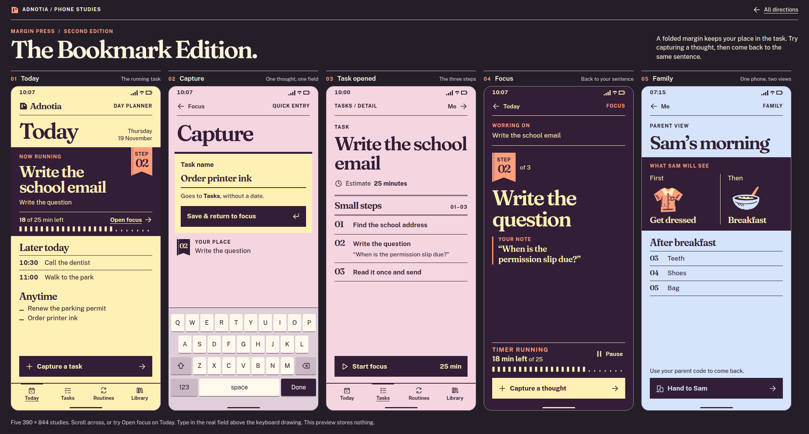
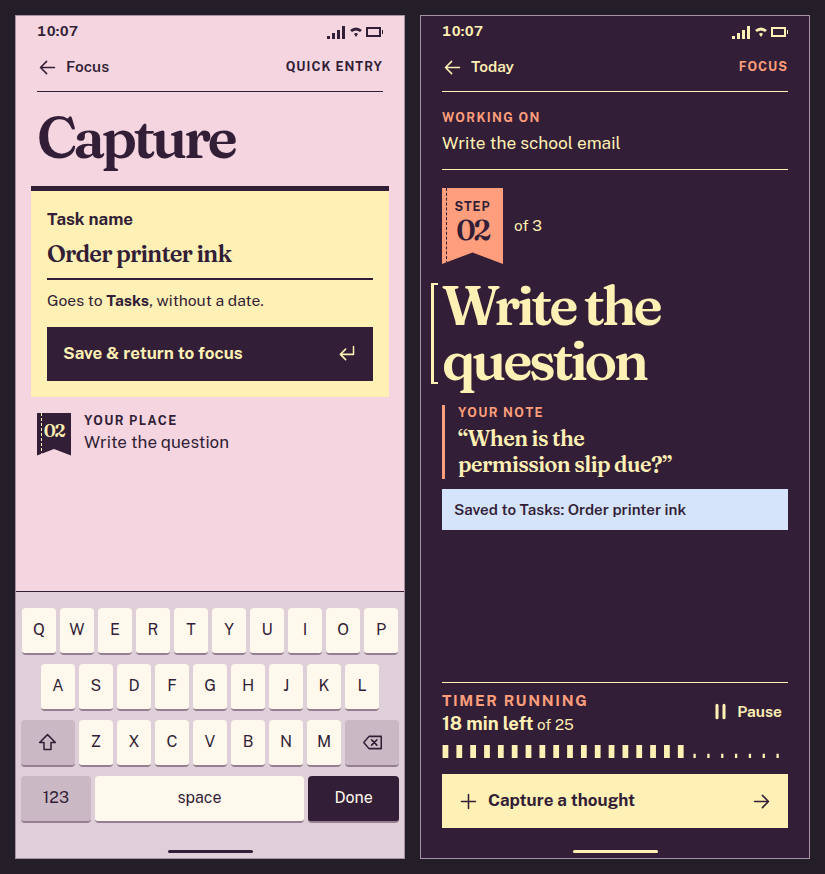

# Adnotia / phone studies

**Open [index.html](index.html) from disk.** Start with [The Bookmark Edition](bookmark-edition.html), or choose one of the three original directions. Each file shows five 390 × 844 phone screens side by side. Scroll across on a small screen. No server, framework, font service or build step is needed.

The [research notebook](RESEARCH.md) precedes the drawings. Its ten principles are design constraints and hypotheses, not clinical claims. The original three directions explore different ways of drawing a task. The featured study takes one of them further.

## Featured · [The Bookmark Edition](bookmark-edition.html)

**Chosen colours:** [the same five screens in charcoal and terracotta](bookmark-edition-charcoal.html). This is the direction and palette the owner chose; see `docs/decisions/ADR-045`. Only the colour values differ from the file described below, and the contrast figures in the table below do not apply to it: ADR-045 gives its own.

**A notched bookmark carries the current step from Today into Capture and back into Focus.** The number tells you where you are; the words tell you what to do. In the first Margin Press, the biggest thing on Today looked tappable but wasn't. Here the whole school-email headline opens the running session. In Focus, “Write the question” gets the biggest type, not the clock.

**Try the interruption.** On Today, choose **Open focus**. Notice the sentence “When is the permission slip due?” Choose **Capture a thought**, type **Order printer ink**, then press **Save & return to focus** or the keyboard’s **Done** (Enter on a computer). The receipt appears **below** the sentence. Step 02, the sentence and the 18 minutes left stay where they were. Try leaving Capture without saving, too: the draft is still there when you come back.

**Saved screenshots:** [five-screen board PNG](screenshots/bookmark-edition.png) · [Capture beside the returned Focus screen](screenshots/capture-and-return.png).

- **From the reading:** W3C’s “Let Users Go Back” suggests returning to the same point, not just the same section. Apple’s keyboard guidance informed the one-field slip with Save above the keyboard. These extend principles 4 and 5 in the [second-pass notes](RESEARCH.md#second-pass-what-happens-during-an-interruption). The change in type scale follows the Mela reading (6); a literal count accompanies the printing strokes (2). The first/then preview uses original shirt and bowl drawings alongside the words, applying the parent/child distinction (8).
- **Type:** Fraunces Semibold sets the task, instruction, saved-place number and quoted sentence. Public Sans sets controls, appointment times and context so they don’t read like part of the task. The colours distinguish sheets and ink; none of these choices is an intervention for ADHD.
- **Navigation:** Today, Capture, Task, Focus and Family have **5 / 3 / 5 / 3 / 2** actionable controls in their opening stills, counting the input, Back and every available tab separately. The four named tabs stay in order; the selected tab is a location, not an action. **Me** is in the headers of Tasks, Routines and Library. **Me → Family → Hand to Sam** opens a preview with no adult navigation. Settings and Medication are named in Me; their contents are not drawn.
- **Different moments, not five simultaneous screens:** the opened task at 10:00 starts at step 01 with 25 minutes. Opening Tasks **from Today** at 10:07 instead shows step 01 done, step 02 current and **Open focus**, not Start. Capture from Today returns to Today. The times are held still for comparison; Pause/Resume previews the state change, not a ticking clock.
- **Limits:** a small inline script changes the displayed still, input focus, receipt, pause label and child preview. There is no task store, analytics or app connection. Save shows what would go into Tasks; it does not append another printer-ink row to the sample day. Text stays in page memory, never in the URL or browser storage. The keyboard drawing is not a second set of controls: type in the real field. On a touch device, focusing the field hides the drawing to make room for the device keyboard. The handoff is an opaque modal with a reviewer exit, not a working parent-code gate or a device lock.
- **Worry / next observation:** Me now costs an extra tap from Today. Give a parent the phone on Today and ask them to hand it to Sam without naming a tab. Separately, ask someone to capture an unrelated thought mid-email, then tell you their next sentence without prompting. Try both on physical phones with large type and the person’s usual keyboard; a desktop drawing cannot tell us whether either route feels natural.

| Text / surface (either order) | Contrast |
| --- | ---: |
| Plum `#321E36` / paper `#FFF0B5` — Today, Focus, primary actions and gallery feature | 13.37:1 |
| Plum `#321E36` / ribbon `#FF9E7C` — numbered bookmark and Focus labels | 7.59:1 |
| Plum `#321E36` / pink `#F5D6E0` — Capture and task detail | 11.33:1 |
| Plum `#321E36` / blue `#D5E4FA` — Family, handoff and Save receipt | 11.86:1 |
| Placeholder `#63485C` / paper `#FFF0B5` | 7.04:1 |
| Plum `#321E36` / key `#FFF9ED` or modifier `#CAB8C5` — keyboard drawing on `#DECFD9` | 14.57:1 / 8.13:1 |
| Chalk `#FFF3DD`, muted type `#D7C8D4` or ribbon `#FF9E7C` / desk `#241E29` — board captions | 14.79:1 / 10.13:1 / 8.07:1 |

Checked the gallery and the five new stills from disk in Chromium with the network offline, including Save from each origin, Back with an unsaved draft, Pause/Resume and the handoff. At 390 × 844 all five fit; the action targets measure at least 48 × 48 CSS px. With a 200% root text size the frames can scroll vertically instead of clipping the instructions. These are browser checks, not usability testing or native Dynamic Type, VoiceOver or TalkBack results.

## A · [Margin Press](direction-a.html)

**The current task is the lead headline in a two-ink daily edition, with a rule of type marking the minutes left.** The top story gets solid ink; appointments get a narrow time column; anytime work gets neither a clock nor a box. The timer is made of 25 printing strokes: 18 tall and seven short, with the literal count beside them. Capture is a single writable slip. In Family, the order is a numbered contents list and the child preview is a short excerpt.

- **From the reading:** Mela changes the scale of the same words when the job changes (principles 3 and 6). CapWords makes the result look like the thing just captured (4); grug shows how much identity can reside in lettering alone (9). Here it is typesetting, not a copied word card or hand-drawn alphabet.
- **Type:** Fraunces Semibold for headlines, step numbers and the big remaining-time figure; its contrasting strokes make the title look set in ink. Public Sans for instructions, times and controls; it keeps a long line of task copy quieter than the headline.
- **Worry:** a long title or larger text setting could push the first appointment below the fold. A repeated rule could become visual noise. Test with a two-line translation and the largest native text setting; the numeric timer must still work if the rule is removed.

| Ink / surface (either order) | Contrast |
| --- | ---: |
| Plum `#361936` / butter `#FFE99A` — default, running panel and button | 12.88:1 |
| Plum `#361936` / pink `#F5CEE3` — Capture, Family and menu | 10.98:1 |

## B · [Rivet Dial](direction-b.html)

**A task is a reading on a calibrated dial; timed stops line up against a single measuring rail.** The title and remaining time sit side by side. The arc shows 18/25 by length and by the position of its pointer. Scheduled events have a stem and a time; anytime entries are off the stem. The same rail can carry a sequence rather than a clock in task detail and Family. In Focus, the dial takes the space previously given to the rail.

- **From the reading:** Tide Guide and the Flighty design studies give a reading both a position and a number (2, 6). Llama Life reviewers distinguish shifting estimates from fixed appointments (1). Marvin's moving-target complaint is why every control stays put and the sweep is static (7, 10).
- **Type:** Barlow Condensed Semibold gives task names and tall instrument numerals room side by side. IBM Plex Mono is reserved mainly for readings, units and navigation: times line up, and the units don't look like part of the task name.
- **Worry:** a gauge can imply a target to hit, or suggest elapsed instead of remaining time. Dark navy is an identity choice, not a recommended mode. In a daylight test, ask what the needle means without explaining it. If the answer is “how well I'm doing”, change the instrument.

| Foreground | On midnight `#10182D` | On slate `#23314C` |
| --- | ---: | ---: |
| Porcelain `#E7EFFF` — names and instructions | 15.28:1 | 11.26:1 |
| Silver `#AEBFDC` — units, indices and secondary labels | 9.48:1 | 6.99:1 |
| Lime `#D8F780` — active reading and control face | 14.73:1 | 10.86:1 |

The primary control reverses midnight/lime, also 14.73:1. The pointer, the idle arc and the words “min left” remain different without hue.

## C · [Pocket Props](direction-c.html)

**A task is a cut-paper prop: it comes forward on a small stage while the rest of the day waits in the wings.** The school letter recurs on Today, in the capture pocket and on the opened task. Two later appointments share the width like a pair of objects on a shelf. In Focus the word and the sandglass take centre stage, with the current instruction on a separate strip below. Sam's shirt is a preview of the first action, not an avatar to maintain.

- **From the reading:** CapWords makes an object the unit of recognition (3, 9); the parent-made Morning Routine board shows why a shirt can say something useful that a generic reward cannot (8). Focus Friend reviews argue both for an identifiable object and against making an interruption cost something (5). The props here are original SVG silhouettes; no one chooses an icon as a condition of capture.
- **Type:** Bricolage Grotesque for the broad, irregular silhouettes of names and headlines; Atkinson Hyperlegible for directions and times, where clearly differentiated letterforms matter more than a display voice. Neither is prescribed for ADHD.
- **Worry:** custom tasks will not all have an apt illustration, and the look may feel too young to some adults. Test an unpictured task and a long name in the two-column row. A text-only task must feel finished; don't turn icon selection into a new job.

| Ink / surface (either order) | Contrast |
| --- | ---: |
| Ink `#17214D` / sky `#C8DAFF` | 10.97:1 |
| Ink `#17214D` / apricot `#FFB48E` | 8.94:1 |
| Ink `#17214D` / cream `#FFF0BD` | 13.56:1 |
| Cream `#FFF0BD` / stage blue `#293E99` | 8.22:1 |

## What the original A–C controls demonstrate

The three originals use **HTML and CSS only**. Their five frames are **snapshots, not simultaneous app state**. Capture shows the example name being entered at 09:58. The opened task is ready to start at 10:00. Today and Focus show the same task at 10:07, with 18 minutes left of the original 25. Family shows a different, earlier part of the morning. Editing a field does not change the sample in another frame.

- **Today → Capture:** one name and Save; no date, estimate or categorisation required. The confirmation explains that the file stores nothing. A capture without a date belongs in Tasks, not automatically in today's Anytime group.
- **Today / Tasks / Routines / Library:** four labelled destinations. The selected destination is marked, not a redundant action. In these studies Tasks opens the example task inside that destination. Routines and Library explain the destinations not drawn. In the detail, Start opens Focus; Pause previews a stop with the same remaining time. Capture and Focus put the tabs away and keep a labelled return to Today.
- **Today → Me → Family → Hand to Sam:** the parent sees all five steps; the handoff preview shows only the first instruction and what follows. Its close control is for the reviewer. The intended app would require the parent code to return, not claim to lock the operating system. Me also names Settings and the separate Medication destination; neither section is drawn and neither feeds these screens.

The five default frames have **5 / 3 / 5 / 2 / 2** actionable controls respectively, even counting the input, Back and inactive tabs. Today's large running readout is information, not a second, competing button. A trade-off worth testing in all three: do people expect to tap that readout to resume? Nothing animates, alerts, scores, resets or reports a missed day.

## Reading the boards

Contrast is `(lighter relative luminance + 0.05) / (darker + 0.05)` in sRGB, rounded to two decimals. The common gallery uses `#FAF3DE` on `#191C25` (15.35:1); direction labels use butter (14.08:1), lime (14.21:1) or apricot (9.86:1) on the same ground. `#838897` is a gallery rule/outline, not body text. The index borrows each direction's display face for its title and uses Public Sans for its own copy.

All six typefaces are unmodified Latin WOFF2 subsets distributed by Fontsource under the SIL Open Font License 1.1. The fonts, copyright notices and licence text are embedded in the HTML files that use them. The type and artwork travel with the file.

Checked the original A–C boards opened as local files with the network offline: all fifteen original frames fit at the reference size, every actionable target is at least 48 × 48 CSS px, and the text pairs clear 4.5:1 including menus, feedback and preview controls. These are checks on the drawings, **not** tests with users or native Dynamic Type, VoiceOver or TalkBack.
